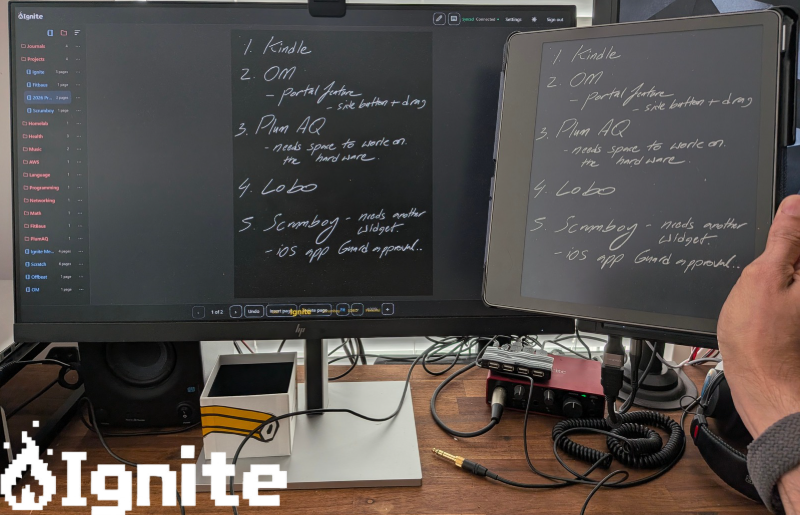

**Ignite** is an open-source **Kindle Scribe notebook replacement**: local
handwriting, durable notebooks on-device, a one-file installer for prepared
Kindles, and **optional** self-hosted sync.

> Ignite requires a Kindle that is **already prepared** for third-party apps
> (jailbreak / community tooling, SH Integration, root helper). It does **not**
> jailbreak a stock Kindle and does **not** claim support for every Kindle
> generation. For jailbreaking, follow the community guide at
> [kindlemodding.org/jailbreaking](https://kindlemodding.org/jailbreaking/).

## Table of Contents

- [Features](#features)
- [Install on Kindle](#install-on-kindle)
- [Device compatibility](#device-compatibility)
- [Optional self-hosted sync](#optional-self-hosted-sync)
- [Status](#status)
- [Repository layout](#repository-layout)
- [Build from source](#build-from-source)
- [Development setup](#development-setup)
- [Architecture](#architecture)
- [Experimental recovery](#experimental-recovery)
- [Known limitations](#known-limitations)
- [Contributing](#contributing)
- [Third-party notices](#third-party-notices)
- [License](#license)

## Features

- Multi-stroke notebook editing on Kindle Scribe
- On-device library, tools, and durable page storage
- One-file customer installer (`Install Ignite vX.Y.Z.sh`) plus Diagnose / Backup / Uninstall helpers
- Optional LAN sync with a self-hosted **Ignite Server** and browser companion
- This is a work in progress; new features are still being added

Authentic application screenshots (library, handwriting, optional sync) are
captured on hardware during release qualification and will live under
[`docs/images/`](docs/images/) — not generated substitutes.

## Install on Kindle

1. Prepare a compatible Kindle Scribe using the
   [Kindle Modding jailbreak guide](https://kindlemodding.org/jailbreaking/)
   (SH Integration and a root helper are required).
2. From [GitHub Releases](https://github.com/markrai/ignite/releases) download
   `Install Ignite vX.Y.Z.sh` and `Install Ignite vX.Y.Z.sha256`.
3. Verify the checksum (`sha256sum -c "Install Ignite vX.Y.Z.sha256"`).
4. Copy **only** the installer into the Kindle **Documents** folder over USB.
5. Eject the Kindle, then open **Install Ignite** on the device.
6. Open **Ignite** from the Library.

A stock, non-jailbroken Kindle cannot run Ignite. Full customer steps:
[`deployment/kindle/README.txt`](deployment/kindle/README.txt). Problems:
[`docs/troubleshooting.md`](docs/troubleshooting.md).

Application registration identity is `com.markrai.ignite` (from 0.9.11).
Upgrading from 0.9.10 migrates the older `com.markrai.scribe` handler;
notebooks stay at `/mnt/us/scribe-data`.

## Device compatibility

See [`docs/compatibility.md`](docs/compatibility.md). Do not treat unverified
firmware as supported.

- **Verified:** Kindle Scribe (1st generation), firmware **5.18.6**, 32-bit ARM
- **Tester / in progress:** 2024 Scribe polarity path (firmware **5.19.6**)

## Optional self-hosted sync

Ignite stores notebooks on the Kindle without a server. Ignite Server is
optional: it syncs notebooks between a prepared Kindle and a browser on a
**trusted LAN** (plain HTTP — do not expose the port to the public Internet).

- Native Linux install and updates: [`docs/self-hosting.md`](docs/self-hosting.md)
- Docker / Portainer (`ghcr.io/markrai/ignite-server`): [`deployment/linux/docker/README.md`](deployment/linux/docker/README.md)

The Kindle installer and the Linux/Docker server are separate artifacts on the
same GitHub Release.

## Status

| Area | Status |
|------|--------|
| Kindle app + installer | Active development / beta |
| Self-hosted sync server | **Ignite Server** — portable Linux bundle and GHCR image |
| Web companion | **ignite-web** in `ignite/web/` |
| Experimental recovery | **Disabled** in product builds (see below) |

Version: see [`ignite/VERSION`](ignite/VERSION).

**Project board:** Follow current and planned work on the [public Ignite Kanban board](https://scrumboy.com/ignite).

Releases are **promoted** from a hardware-tested CI artifact (exact bytes, no
rebuild). See [`docs/release-packaging.md`](docs/release-packaging.md).

## Repository layout

This outer directory is a **development workspace**. The Ignite product lives
under the inner `ignite/` tree (including `ignite/web/`). An optional `scribe/`
directory may sit as a **sibling of `ignite/` inside this same workspace** for
local native-Scribe work; it is not part of the Ignite product tree and is not
moved or merged by Ignite tooling.

```text
C:\dev\project\ignite\          (outer workspace / this repository root)
  ignite\                       Ignite product
    core\                       Shared Rust crates (notebook, sync protocol/engine)
    kindle\                     Kindle runtime (scribe-app, platform, lifecycle)
    server\                     Self-hosted sync / control servers
    web\                        ignite-web (browser replica + PWA)
    assets\                     Fonts + third-party notices
  scribe\                       Optional local native-Scribe work (not Ignite product)
  deployment\kindle\            Installer, SFX, pytest, shared packager
  deployment\linux\             Ignite Server portable Linux bundle + acceptance tests
  scripts\kindle\               Thin packaging wrappers
  tools\                        Cross-build, Dropbear client, launcher, promote-publish
  docs\                         Architecture, troubleshooting, compatibility, self-hosting
```

## Build from source

### Host tools

- Recent stable Rust (`rustup`)
- Optional: Docker (Kindle ARMv7hf + Dropbear builds; images are digest-pinned)
- Python 3 + pytest (installer tests)

### Rust workspace (no Kindle required)

```bash
cargo test --workspace --locked
cargo test -p scribe-app --lib --locked
```

### Kindle ARMv7hf binaries and customer installer

Official packaging always rebuilds (no `-SkipBuild`):

```bash
bash scripts/kindle/package-release.sh
```

Windows developers can use `.\scripts\kindle\package-release.ps1` (Docker Desktop).
Staging lives in [`deployment/kindle/package_release.py`](deployment/kindle/package_release.py).
`ink-probe` is built as a check artifact and is **not** shipped in the customer Scriptlet.

Details: [`docs/release-packaging.md`](docs/release-packaging.md),
[`CONTRIBUTING.md`](CONTRIBUTING.md).

## Development setup

See [`CONTRIBUTING.md`](CONTRIBUTING.md). Default tests use disposable temp
dirs and loopback sockets only—no production credentials or device required.

## Architecture

Concise overview: [`docs/architecture.md`](docs/architecture.md).

## Experimental recovery

Ignite’s tree includes research/recovery modules and a verified protected
Dropbear transport path on Kindle hardware. **Publishing source does not
activate recovery.**

- `LIVE_NON_LOOPBACK_POST_ENABLED = false`
- Ordinary startup does not submit recovery operations
- No production SSH keys or host pins are bundled
- Test-only `kindle-supervisor-harness` is excluded from the customer Scriptlet

Real historical recovery remains a separate, controlled process—not a
prerequisite for using Ignite as a notebook.

## Known limitations

- Compatibility beyond verified Scribe firmware is incomplete
- Sync servers are plain HTTP for LAN/self-host use—do not expose casually
- Review 79 (performance investigation) remains open
- ignite-web Playwright E2E coverage has been run on Chromium; Firefox and
  WebKit/Safari E2E suites have not yet been executed in this migration, so
  compatibility on those browsers remains unverified
- Ignite Server portable Linux packaging is validated with disposable staging
  tests; optional Compose/Portainer image under `deployment/linux/docker/`

## Contributing

See [`CONTRIBUTING.md`](CONTRIBUTING.md). Security reports:
[`SECURITY.md`](SECURITY.md).

## Third-party notices

Fonts (SIL OFL), Dropbear (upstream permissive license, build-time fetch), and
Rust crate licenses: [`ignite/assets/THIRD_PARTY_NOTICES.md`](ignite/assets/THIRD_PARTY_NOTICES.md).

## License

[GNU Affero General Public License v3.0 only](LICENSE) (AGPL-3.0-only).
